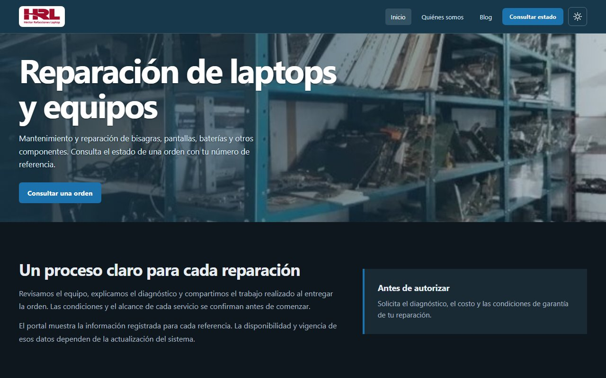
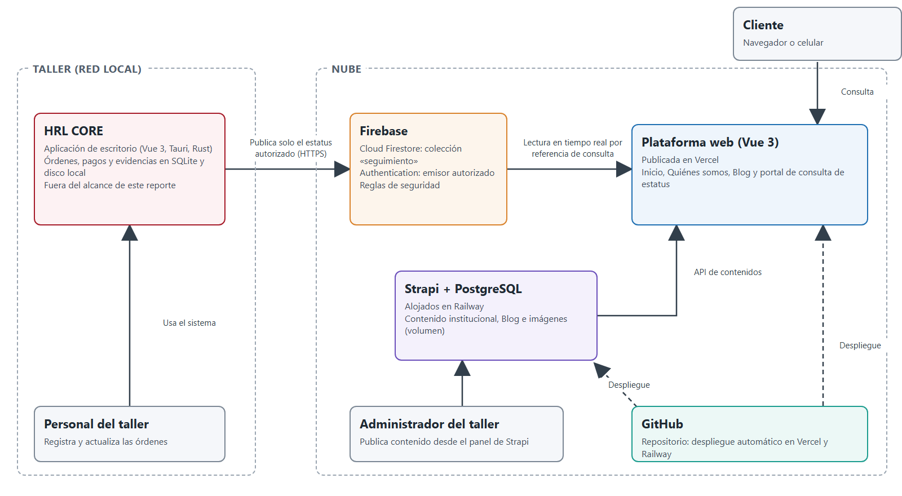
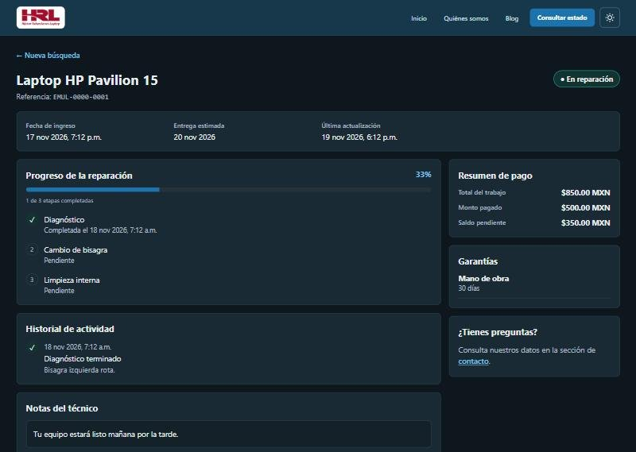
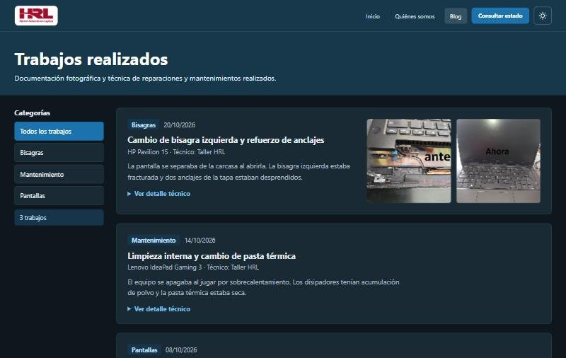

# HRL Refacciones Laptops · Plataforma web

Plataforma web para HRL Refacciones Laptops, un taller de servicio técnico y venta de refacciones en Playa del Carmen, Quintana Roo. Reúne el sitio institucional del taller, un blog de trabajos realizados que el personal administra sin tocar código y un portal donde cada cliente consulta en tiempo real el estado de su reparación con su número de referencia.

**Sitio publicado:** https://proyecto-estadias-self.vercel.app



> Proyecto de estadía profesional del programa de Técnico Superior Universitario en Desarrollo de Software Multiplataforma de la Universidad Tecnológica de la Riviera Maya (2026).

## Visión general

Antes de la plataforma, los clientes preguntaban por teléfono o mensaje cómo iba su equipo, y cada consulta interrumpía el trabajo técnico. La plataforma resuelve eso con tres partes:

- **Sitio institucional:** inicio, servicios, proceso de trabajo, contacto con mapa y «Quiénes somos».
- **Blog / portafolio:** trabajos realizados con fotografías de antes y después, filtrados por categoría. Solo se publican los trabajos con consentimiento del cliente.
- **Portal de consulta de estatus:** el cliente escribe su referencia (o escanea el QR de su orden) y ve el equipo, las etapas de la reparación, el historial, las notas del técnico, el resumen de pago y la garantía. Los cambios aparecen sin recargar la página.

El estatus de cada orden lo publica [HRL CORE](https://github.com/Crep16/HRL-CORE), el sistema de escritorio del taller, en Cloud Firestore. Esta plataforma solo lee lo que el taller autoriza publicar.

## Stack principal

- Vue 3 con Composition API y componentes SFC
- Vite como herramienta de desarrollo y build
- Pinia para el estado global y Vue Router para la navegación
- Strapi 5 como gestor de contenidos, con PostgreSQL en producción y SQLite en local
- Firebase: Cloud Firestore para el estatus de las órdenes, con reglas de seguridad propias
- Vercel para el frontend y Railway para Strapi y PostgreSQL

## Arquitectura



- **HRL CORE → Firestore:** el sistema del taller publica solo el estatus autorizado de cada orden en la colección `seguimiento`, con una sola cuenta emisora.
- **Firestore → portal:** el portal escucha el documento de la referencia consultada con `onSnapshot`, así que cada cambio se refleja al instante.
- **Strapi → sitio y blog:** el administrador del taller edita textos, servicios, contacto y trabajos del blog desde el panel de Strapi.
- **GitHub → Vercel y Railway:** cada cambio en el repositorio se despliega automáticamente.

El acuerdo de datos entre los dos sistemas está documentado en [docs/CONTRATO-FIRESTORE.md](docs/CONTRATO-FIRESTORE.md).

## Estado del proyecto

- [x] Sitio institucional con contenido administrable desde Strapi
- [x] Blog / portafolio con filtro por categoría y consentimiento del cliente
- [x] Portal de consulta de estatus en tiempo real con Cloud Firestore
- [x] Reglas de seguridad de Firestore con 35 pruebas automatizadas
- [x] Despliegue en Vercel (frontend) y Railway (Strapi + PostgreSQL)
- [x] Integración verificada con una orden real publicada desde HRL CORE
- [ ] Prueba de sincronización en producción junto con HRL CORE
- [ ] Medición en el taller después de la implementación

## Cómo empezar

Requisitos: Node.js 20 o superior y npm.

```bash
git clone https://github.com/VictorJose2073/Proyecto-estadias.git
cd Proyecto-estadias
npm install --prefix backend
npm install --prefix frontend
cp backend/.env.example backend/.env
cp frontend/.env.example frontend/.env.local
npm run dev
```

`npm run dev` en la raíz levanta Strapi y Vite a la vez. El panel de Strapi queda en http://localhost:1337/admin y el sitio en la dirección que muestre Vite.

## Variables de entorno

Cada carpeta tiene su archivo `.env.example` como plantilla. Los archivos `.env` reales están ignorados por git y nunca se suben al repositorio.

**Frontend** (`frontend/.env.local`)

| Variable | Uso |
| --- | --- |
| VITE_STRAPI_URL | Dirección de la API de Strapi |
| VITE_FIREBASE_API_KEY | Clave web de Firebase |
| VITE_FIREBASE_AUTH_DOMAIN | Dominio de autenticación de Firebase |
| VITE_FIREBASE_PROJECT_ID | ID del proyecto de Firebase |
| VITE_FIREBASE_APP_ID | ID de la aplicación web en Firebase |

**Backend** (`backend/.env`)

| Variable | Uso |
| --- | --- |
| HOST, PORT | Dirección y puerto de Strapi |
| APP_KEYS, ADMIN_JWT_SECRET, API_TOKEN_SALT, TRANSFER_TOKEN_SALT, ENCRYPTION_KEY, JWT_SECRET | Secretos de Strapi |
| CORS_ORIGINS | Dominios autorizados para consumir la API |
| DATABASE_CLIENT | `sqlite` en local o `postgres` en producción |
| DATABASE_HOST, DATABASE_PORT, DATABASE_NAME, DATABASE_USERNAME, DATABASE_PASSWORD, DATABASE_SSL | Conexión a PostgreSQL |
| DATABASE_FILENAME | Archivo de SQLite en local |

## Scripts disponibles

```bash
npm run dev          # raíz: Strapi y Vite a la vez
npm run dev:back     # raíz: solo Strapi
npm run dev:front    # raíz: solo el frontend
npm run build --prefix frontend   # build de producción del sitio
npm test --prefix tests/reglas    # pruebas de las reglas de Firestore
```

## Pruebas

Las reglas de seguridad de Cloud Firestore se prueban con el emulador de Firebase (requiere Java 21 y `firebase-tools`):

```bash
npm install --prefix tests/reglas
npm test --prefix tests/reglas
```

Las 35 pruebas comprueban, entre otras cosas, que nadie pueda listar la colección ni escribir sin la cuenta emisora, que cada revisión sea mayor que la anterior, que la huella SHA-256 coincida y que el acceso expire siete días después de la entrega.

Además, sobre el sitio publicado se aplicó una lista de verificación funcional: diez de once pruebas se cumplieron y una se cumplió parcialmente. En Lighthouse (móvil), la página de inicio obtuvo 97 en rendimiento y las páginas evaluadas, 100 en accesibilidad.

## Estructura del proyecto

```text
Proyecto-estadias/
├── frontend/               # sitio en Vue 3
│   └── src/
│       ├── components/     # barra de navegación, pie de página, visor de fotos
│       ├── views/          # inicio, quiénes somos, blog, portal y estado del trabajo
│       ├── services/       # acceso a Strapi y a Cloud Firestore
│       ├── stores/         # estado global con Pinia
│       ├── styles/         # hojas de estilo por vista, tema claro y oscuro
│       └── router/
├── backend/                # Strapi 5
│   ├── config/             # servidor, base de datos, CORS
│   ├── src/api/            # tipos de contenido: servicios, trabajos, categorías, contacto...
│   └── scripts/            # migración de SQLite a PostgreSQL y carga inicial
├── tests/reglas/           # pruebas de las reglas de Firestore
├── docs/                   # contrato de datos con HRL CORE e imágenes
├── firestore.rules         # reglas de seguridad de Cloud Firestore
├── firebase.json
├── DESIGN.md               # dirección visual: colores, temas y componentes
└── scripts/dev.js          # arranque conjunto de Strapi y Vite
```

## Despliegue

- **Frontend en Vercel:** directorio raíz `frontend`, build con `npm run build` y salida en `dist`. El archivo `frontend/vercel.json` redirige todas las rutas a `index.html` para que Vue Router funcione al recargar.
- **Strapi en Railway:** directorio raíz `backend`, con PostgreSQL en el mismo proyecto y un volumen montado en `/app/public` para conservar las imágenes subidas. El comando de inicio es `mkdir -p public/uploads && npm run start`.
- Las variables de entorno se configuran en el panel de cada plataforma, nunca en el repositorio.

## Capturas

**Portal de consulta de estatus**



**Blog de trabajos realizados**



## Autoría

Desarrollado por [VictorJose2073](https://github.com/VictorJose2073) como proyecto de estadía en HRL Refacciones Laptops. El sistema de escritorio HRL CORE es desarrollo de [Crep16](https://github.com/Crep16).
